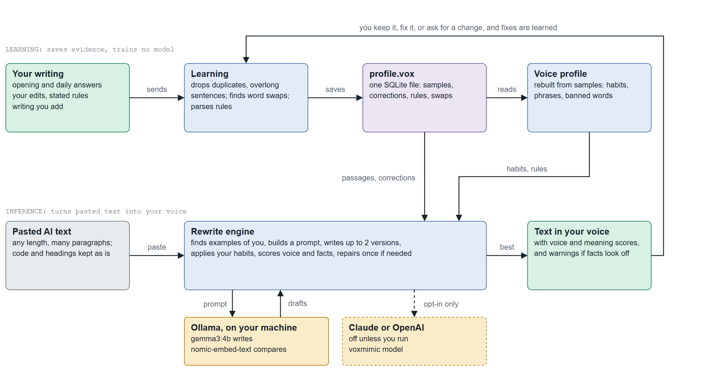

# VoxMimic

[](https://github.com/iam-saiteja/VoxMimic/actions/workflows/tests.yml)
[](LICENSE)


> Paste AI text. Get it back sounding like you.

VoxMimic asks how you talk, learns your habits, and rewrites AI-generated text in your voice. It runs on your machine, and it keeps learning: one question and one sentence a day, plus every fix you make.

```
$ voxmimic

Today's question (i know least about how you sound talking about work)
What are you working on right now? Tell it like you would to a friend.
> mostly just fixing bugs honestly, nothing exciting

Would you say this?
  this week i just made a lot of progress on the main things, honestly.
> nah i'd just say it took way longer than i thought
Got it. Saved that as how you'd put it.

Paste anything and i'll put it in your voice.
> It is important to note that the migration was completed on Tuesday, with 98% of records transferred.

  Furthermore, we will leverage the new pipeline to enhance reliability. Please contact Priya with any questions.

okay so the migration was finished on tuesday, and 98% of the records made it over.

okay, so we'll use the new system to make things more reliable. you should just talk to priya if you have any questions.

sounds like you: 18 → 67  ·  meaning kept: 92%

> shorter
```

That rewrite is real output from `gemma3:4b` after only six short answers. It's a fair first guess, and notice it isn't perfect: it opens with "okay" twice, and "pipeline" became "system". That's what the daily corrections are for.



There's one box to type in, and it works out what you meant:

| You type | It does |
|---|---|
| Any pasted text | Rewrites it in your voice. Code blocks, headings and lists keep their shape. |
| `shorter`, `too formal`, `a bit warmer` | Changes the last result. |
| `for my boss` | Redoes it for that reader. |
| Your own edited version of the result | Learns from what you changed. |
| `never say "leverage"`, `no em dashes` | Follows that from now on. |
| `learn: something you wrote` | Adds it to what it knows about you. |
| `/copy` `/why` `/me` `/undo` `/forget` `/help` | Copies, explains, shows your profile, forgets the last lesson, removes an earlier one, lists everything. |

## Install

You need Python 3.10 or newer, and [Ollama](https://ollama.com) for the local model.

**1. Install VoxMimic.** [pipx](https://pipx.pypa.io) puts the `voxmimic` command on your path, with no virtual environment to activate:

```bash
pipx install git+https://github.com/iam-saiteja/VoxMimic.git
```

Or with plain pip, inside a virtual environment: `pip install git+https://github.com/iam-saiteja/VoxMimic.git`

**2. Get the models.** About 3.6GB in total. Everything runs on your machine, and `gemma3:4b` fits on a 4GB GPU.

```bash
ollama pull gemma3:4b
ollama pull nomic-embed-text    # optional, but it makes example matching and the meaning checks much more accurate
```

**3. Check, then start.**

```bash
voxmimic doctor    # says what's missing and how to fix it
voxmimic
```

Without a model it still works, using rules only: it removes AI phrasing and applies your punctuation and casing habits, but it can't restructure sentences.

## How it learns

**The profile is rebuilt from everything you've written**, weighted by word count and recency. One short answer moves it by its share of your words. Delete a sample and its influence is gone.

**The daily question goes after your blind spot.** It tracks how much it has seen of you telling stories, explaining, arguing, texting, emailing and so on, and asks about whichever is thinnest. Every so often it asks about your preferences outright, since one stated rule can settle what would take weeks to measure.

**The daily sentence tests the profile.** It rewrites a stiff sentence as its best guess at how you'd say it. Keep it or fix it. Fixes teach the most, because they're before/after pairs in your own words. How much you have to change is also the honest measure of progress, and `voxmimic inspect` tracks it over time.

**Only your writing teaches it.** Text you paste for rewriting is never learned from, kept sentences aren't added to your writing samples, and `voxmimic add` turns away text that looks AI-written. If you answer the daily sentence with a complaint instead of a better version, it's saved as a rule rather than as your writing.

**Architecture diagrams** are in `architecture/`: `voxmimic-architecture.drawio` opens in [draw.io](https://app.diagrams.net) with one tab per section, and there's a PNG of each tab.

## How a rewrite works

1. **Find examples.** It picks the passages of your writing closest to the text, favouring the same kind of writing, so an email learns from your emails. Each is paired with a stiff AI version of itself, which gives the model before/after examples ending in your real words. Your corrections rank first.
2. **Generate up to two candidates** from those examples and measured instructions like "sentences average 9 words", rather than adjectives like "casual". It stops at one when the first is already good.
3. **Apply your habits with rules**, the things a model can't be trusted to keep: casing, contractions, dashes, banned words, and word swaps you've taught it.
4. **Score each one** for voice, meaning, and facts. Dropped or invented numbers and names, sentences left out, flipped negations, made-up personal stories, and replies that talk about the task instead of doing it all count against a candidate or disqualify it.
5. **Repair once** if the best still has a real problem, telling the model exactly what's wrong. A low voice score alone doesn't trigger this: testing showed it cost time and bought nothing.
6. **Warn you** about anything still doubtful. It never hides a problem it noticed.

## Does it work?

`evals/run_eval.py` rewrites 6 unseen passages for each of two opposite writers (12 rewrites) with `gemma3:4b`, against a control: the same model told to "rewrite this in a casual, human style".

| | VoxMimic | Plain prompt |
|---|---|---|
| Voice score, casual writer (from 20) | **69** | 44 |
| Voice score, formal writer (from 39) | **51** | 44 |
| Closer to its own writer than to the other | **12/12** | 6/12 |
| No facts lost or invented | **12/12** | 8/12 |
| Time per passage, on a 4GB GPU | 6 to 7s | 3s |

Teaching it a word works too: after two corrections from "people" to "folks", it used "folks" on new text.

Treat these as evidence that the pieces work, not as proof it sounds like you:

- **The sample is small and the writers are fictional.** Scores move a few points between runs, and fact results have ranged from 11/12 to 12/12.
- **The voice score is VoxMimic's own measure, and it picks candidates using that same score**, so it has a built-in advantage on that row. The real test is how much you edit the daily sentence.
- **The fact checks are literal.** They catch numbers and names, not everything. In testing, "the deployment" became "the thing we were planning" and passed. Read anything important before you send it.
- **Formal writers move less.** Their writing starts closer to AI, and a small model mostly tidies rather than transforms.

To compare models yourself: `python evals/run_eval.py gemma3:4b other-model --full`. Read the outputs, not just the numbers. In testing, `llama3.2:3b` scored higher on voice by making things up.

## Commands

Plain `voxmimic` covers normal use. These are for scripts and shortcuts:

| Command | What it does |
|---|---|
| `voxmimic convert [FILE]` | Rewrite once. Only the result goes to stdout, so it pipes cleanly. `--for "my boss"` sets the reader. |
| `voxmimic convert -c` | Rewrite your clipboard in place. |
| `voxmimic daily` | Today's question and sentence. |
| `voxmimic add [FILE]` | Feed in writing you already have. `--bulk` takes several pastes. |
| `voxmimic inspect` | What it knows, and whether it's improving. |
| `voxmimic model [SPEC]` | Show or change the model. |
| `voxmimic onboard` | Answer the opening questions again. |
| `voxmimic doctor` | Check the setup and say how to fix what's missing. |

## Choosing a model

It uses local models only, unless you say otherwise. An API key in your environment is never enough to send your writing anywhere.

```bash
voxmimic model ollama:gemma3:4b                 # a specific local model
voxmimic model openai:NAME --base-url URL       # LM Studio, llama.cpp, vLLM, or OpenAI
pipx inject voxmimic anthropic                  # or, with pip: pip install anthropic
voxmimic model anthropic                        # Claude Opus 5.5
voxmimic model auto                             # back to the best local model
```

## Your data

Everything lives in `~/.voxmimic/`. `profile.vox` is a single SQLite file holding your samples, corrections and rules. Delete it and everything's gone. To remove one lesson, use `/forget`.

Text you paste isn't saved. The exception is when you fix or approve a result: that before/after pair is kept as an example, because learning from it is the point.
 An older numpy-format `profile.vox` is migrated on first run, with the original kept as `profile.vox.legacy`.

Set `VOXMIMIC_HOME` to keep it somewhere else.

## Project layout

| Path | What's there |
|---|---|
| `voxmimic/chat.py`, `cli.py`, `ui.py` | The conversation, the commands, and terminal input and output |
| `voxmimic/rewrite.py`, `polish.py`, `checks.py` | The rewrite engine, your habits as rules, and the fact checks |
| `voxmimic/style.py`, `baseline.py` | Measuring a voice, and the AI writing it's compared against |
| `voxmimic/learn.py`, `daily.py`, `questions.py` | Learning from edits and rules, and the daily loop |
| `voxmimic/storage.py`, `llm.py`, `embed.py` | The profile file, and model and embedding access |
| `architecture/` | Diagrams: an editable draw.io file and a PNG of each tab |
| `tests/`, `evals/` | Tests with a fake model, and the real-model evaluation |
| `experiments/vox_t5/` | The retired T5 attempt, with the result that retired it |

## Contributing

Bug reports and pull requests are welcome. [CONTRIBUTING.md](CONTRIBUTING.md) covers setup, tests, and how to check a change to rewriting against the real-model evaluation. Changes are listed in [CHANGELOG.md](CHANGELOG.md).

When reporting a problem, please don't paste your real writing or your profile into a public issue.

## License

[MIT](LICENSE)
